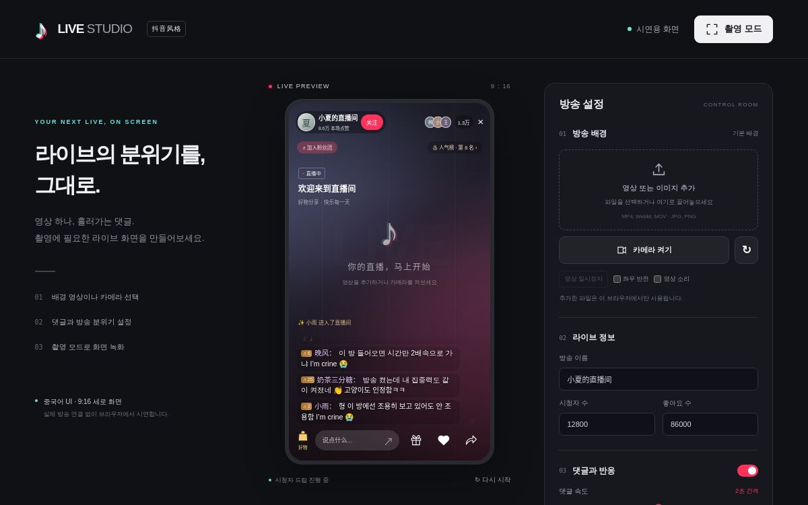
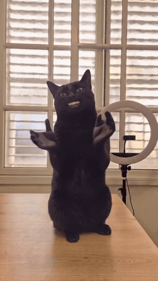

# Douyin Live Studio

**도우인 스타일의 라이브 화면을 만들고 촬영하는 웹 시연 도구입니다.**

영상·사진이나 웹캠을 배경으로 놓고, 한국어·중국어 댓글과 GIF, 얼굴 필터, 폭죽 효과를 더할 수 있습니다. 제품명이나 상품 정보 없이도 라이브 방송 분위기를 연출할 수 있습니다.



[빠른 시작](#빠른-시작) · [주요 기능](#주요-기능) · [사용 방법](#사용-방법) · [단축키](#단축키) · [배포 주소](https://douyin-live-studio.gpt-class2-6.chatgpt.site/)

> 배포 주소에는 사이트의 접근 권한 설정이 적용됩니다. 저장소를 내려받아 로컬에서 실행할 수도 있습니다.

## 주요 기능

| 기능 | 동작 |
| --- | --- |
| 9:16 라이브 화면 | 중국어 방송 UI, 시청자 수, 좋아요 수, 방송 이름을 설정합니다. |
| 배경 선택 | 영상·사진 파일을 불러오거나 웹캠을 켭니다. 좌우 반전과 영상 소리도 조절합니다. |
| 자동 댓글 | 기본 한국어 **75%**, 중국어 **25%**로 표시합니다. 언어 비중과 속도를 바꿀 수 있습니다. |
| 내 댓글에 반응 | 한국어로 말을 걸면 한국어로, 중국어로 말을 걸면 중국어로 답합니다. 원문 인용과 이모지 반응이 붙습니다. |
| 댓글 스크롤 | 최근 **500개**를 보관합니다. 이전 댓글을 읽는 동안 새 댓글이 와도 맨 아래로 끌고 가지 않습니다. |
| 이미지·GIF 댓글 | 댓글 주제에 맞는 밈을 보내며, 클릭하면 확대 이미지와 출처를 확인할 수 있습니다. |
| 얼굴 필터 | 왕눈이 토끼, 돼지코, 콧수염 아저씨 필터가 얼굴 위치를 따라갑니다. |
| 반응 효과 | 네온 폭죽, 무지개 파티와 하트·장미 선물 효과를 사용합니다. 불꽃 효과는 성능 때문에 제거했습니다. |
| 촬영 모드 | 설정 패널을 숨기고 세로 방송 화면만 표시합니다. |

### 이미지·GIF 댓글 예시

| SON 이미지 | 박수 고양이 GIF |
| :---: | :---: |
|  |  |
| 웃긴 필터나 드립에 붙는 이미지 | 칭찬·응원에 붙는 움직이는 반응 |

SON, I’m crine, Black Cat Clapping, Tiptoe, Cartman 반응을 포함합니다. 미디어의 원본 출처와 확인일은 [밈팩 출처](dist/memes/SOURCES.md)에 정리했습니다.

## 빠른 시작

Node.js가 설치된 환경에서 실행합니다. 별도의 패키지 설치나 빌드 과정은 없습니다.

```bash
git clone https://github.com/SbEnChOi/douyin-live-demo.git
cd douyin-live-demo
node preview.mjs
```

브라우저에서 **[http://127.0.0.1:4176](http://127.0.0.1:4176)** 을 엽니다.

실시간 모드는 `npm start`로 로컬 서버를 켠 뒤 터미널에 출력되는 Host 주소를 여세요. 자세한 내용은 [실시간 방송 모드](#실시간-방송-모드)를 참고하세요.

기본 화면은 `dist/index.html`을 직접 열어도 볼 수 있습니다. 웹캠과 얼굴 추적을 사용할 때는 로컬 서버 또는 HTTPS 배포 주소를 사용하세요.

## 사용 방법

1. **방송 배경을 선택합니다.** 영상·사진을 끌어 놓거나 ‘카메라 켜기’를 누릅니다.
2. **방송 분위기를 맞춥니다.** 방송 이름, 시청자 수, 댓글 속도, 언어 비중과 짤 전송 빈도를 조절합니다.
3. **채팅창에 말을 걸어봅니다.** ‘내 댓글에 반응하기’는 기본으로 켜져 있습니다.
4. **필터나 반응 효과를 켭니다.** 설정 버튼, 선물 메뉴 또는 아래 단축키를 사용합니다.
5. **촬영 모드로 전환합니다.** `F`를 누른 뒤 운영체제나 브라우저의 화면 녹화 기능으로 촬영합니다.

### 이렇게 말해보세요

| 입력 예시 | 반응 |
| --- | --- |
| `안녕` | 한국어 인사와 후속 댓글 |
| `내 이름은 민수` → `내 이름 기억나?` | 현재 대화에서 소개한 이름을 기억한 답글 |
| `어떤 필터가 좋아?` → `왜?` | 필터 추천과 이어지는 이유 |
| `ㅋㅋㅋ` / `노잼` / `인정` | 짧은 인터넷 말투에 맞는 반응 |
| `내 댓글 읽어줘` | 내 댓글을 인용한 답글 |
| `SON 짤 보내줘` | SON 이미지가 붙은 댓글 |
| `고양이 박수 GIF 보내줘` | 박수 고양이 GIF 댓글 |

답글은 보통 약 2–4초 뒤 표시되며, 여러 메시지는 순서대로 처리합니다. 자동 댓글을 일시정지해도 내 댓글 답변은 계속합니다. 시청자 반응 기능을 끄면 대기 중인 답글과 이모지도 취소됩니다.

### 댓글 설정

- **자동 댓글 간격:** 기본 약 2초, 설정 범위 0.8–15초. 실제 간격은 약 ±18%씩 달라집니다.
- **언어 비중:** 자동 댓글은 기본 한국어 3 : 중국어 1. 내가 보낸 댓글에는 입력한 언어를 우선합니다.
- **반복 줄이기:** 자동 한국어 댓글은 최근 100개의 문구를 피하며 오래 사용하지 않은 문장을 먼저 고릅니다.
- **이미지·GIF:** 기본 전송 확률 35%, 자동 전송은 최소 12초 간격. 직접 요청하면 간격을 기다리지 않습니다.
- **욕설 강도:** 없음 / 적당히 / 맵게. ‘없음’에서는 강한 자막이 있는 Cartman GIF도 제외합니다.
- **댓글 내역:** 마우스 휠·터치·키보드로 스크롤합니다. ‘新评论’ 버튼을 누르면 최신 댓글로 돌아갑니다.
- **직접 작성한 문구:** 한 줄에 하나씩 등록합니다. 등록한 문구는 작성한 언어 그대로 표시합니다.

## 단축키

| 키 | 기능 |
| --- | --- |
| `1` | 네온 폭죽 |
| `3` | 무지개 파티 |
| `4` | 왕눈이 토끼 필터 |
| `5` | 돼지코 필터 |
| `6` | 콧수염 아저씨 필터 |
| `0` | 반응 효과와 얼굴 필터 해제 |
| `F` | 촬영 모드 켜기·끄기 |
| `Esc` | 설정 화면으로 돌아가기 |

글을 입력하는 동안 효과 단축키는 작동하지 않습니다. 반응 효과는 약 6초 뒤 사라지고, 같은 얼굴 필터를 다시 누르면 해제됩니다.

## 실시간 방송 모드

정적 미리보기와 별도로, 관객 폰의 댓글·후원을 TV에 실시간으로 표시하는 서버가 포함되어 있습니다. 의존성은 없고 Node 22에서 바로 실행됩니다.

```bash
node server.cjs
# 또는
npm start
```

서버가 출력하는 주소 중:

- **Host** `http://127.0.0.1:4177/host?key=...` — 이 노트북에서 한 번 열어 호스트 쿠키를 받습니다. 이후 `/`의 `07 实时直播` 패널과 `/live` TV 스테이지를 사용할 수 있습니다.
- **Join** `http://<LAN-IP>:4177/j?c=...` — 관객 폰이 QR로 여는 주소입니다.
- QR은 TV 스테이지 시작 화면과 좌측 하단에 표시됩니다. 외부 QR API를 쓰지 않고 서버가 SVG로 생성합니다.

### 동작

- 관객은 닉네임만 입력하고 입장합니다. 기본 10명 선착순, 초과 인원은 대기열에 들어가고 자리가 나면 2초 안에 자동 승격됩니다.
- 댓글은 60자, 2초당 1개 수준으로 제한됩니다. 후원은 서버가 가격과 잔액을 검증하는 **시연용 가상 코인**이며 실제 결제는 없습니다.
- 좋아요는 2초 단위로 묶어서 집계합니다.
- 후원 효과는 `hearts`(爱心雨), `fireworks`(烟花盛典), `meteor`(流星雨), `lantern`(孔明灯), `party`(派对时间), `rainbow`(彩虹桥), `rocket`(火箭)로 구성됩니다. 랙이 심했던 `fire`(불꽃) 효과는 제거했습니다.
- 화려한 효과는 **모든 관객 합산 전역 큐**로 4초 간격, 최대 3개까지 대기합니다. 큐가 넘치면 후원 기록과 배너는 남지만 파티클 효과는 생략됩니다.
- 관객은 **미리 다운로드한 한정 밈팩**을 댓글로 보낼 수 있습니다. SON, I'm crine, Black Cat Clapping, Tiptoe, Fanum throws(GIF/IMG), This Is Fine, Surprised Pikachu, Crying Cat, Doge 10종이며 외부 GIF API는 쓰지 않습니다. 욕설이 포함된 Cartman 클립은 관객용 라이브 팩에서 제외했습니다.
- 밈을 추가하려면 `dist/memes/`에 파일을 넣고 `lib/memes.cjs`의 `MEMES`에 항목을 추가한 뒤 서버를 재시작하세요.
- SSE(Server-Sent Events)를 사용합니다. 영상은 서버로 전송하지 않고, TV 스테이지가 노트북 웹캠을 직접 렌더링한 뒤 HDMI로 TV에 출력합니다. Wi-Fi가 끊겨도 카메라 화면은 계속 나가고 댓글/후원만 재연결됩니다.
- 관객 페이지, TV 스테이지, 운영자 패널까지 앱 UI는 중국어입니다. 이 README만 한국어로 유지됩니다.

### TV 스테이지

1. `07 实时直播` 패널에서 **打开电视画面** 버튼을 클릭합니다.
2. TV 스테이지의 **开启摄像头** 버튼으로 웹캠을 허용하고, 필요하면 카메라/左右镜像을 선택합니다.
3. **开始直播** 버튼을 누르면 큰 QR이 작은 QR로 줄고 카메라가 전체 화면으로 나갑니다.
4. 브라우저 창을 HDMI 확장 디스플레이(TV)로 옮기고 전체 화면으로 띄웁니다.
5. 스마트 칠판에는 PPT를 그대로 띄웁니다. 앱은 PPT를 캡처하지 않습니다.

단축키: `Q` QR 숨김/표시, `H` 운영자 바, `F` 전체 화면, `S` 카메라 설정, `C` 댓글 지우기. 효과 테스트는 `1` 폭죽 · `2` 유성우 · `3` 파티 · `4` 하트비 · `5` 등불 · `6` 무지개 · `7` 로켓.

### 네트워크 주의

- 호스트는 반드시 `127.0.0.1`로 접속해야 카메라(`getUserMedia`)가 동작합니다. 관객은 LAN IP로 접속합니다.
- Windows 방화벽에서 Node의 개인 네트워크 인바운드를 허용하세요.
- 학교 Wi-Fi가 client isolation을 걸면 폰이 노트북에 접속하지 못합니다. 이때는 Windows 모바일 핫스팟을 켜고 폰을 여기에 연결하면 됩니다. 앱은 인터넷 없이 동작합니다.
- QR에 `localhost`가 들어가면 폰에서 접속할 수 없습니다. 서버가 자동으로 사설 LAN IP를 고르고, 잘못 고르면 환경 변수로 지정하세요.
  - PowerShell: `$env:LAN_IP="192.168.0.12"; node server.cjs`
  - cmd: `set LAN_IP=192.168.0.12 && node server.cjs`
  - Git Bash: `LAN_IP=192.168.0.12 node server.cjs`
- `.live-config.json`에는 호스트 키와 방 코드가 저장됩니다. Git에 커밋하지 마세요.
- `.openai/hosting.json`의 정적 호스팅에는 SSE 서버가 포함되지 않습니다. 실시간 모드는 노트북에서 `node server.cjs`로 실행하세요.

### 현장 체크

- 노트북은 `127.0.0.1`로 호스트 페이지를 열고, TV는 **HDMI 확장 디스플레이**로 연결하세요. TV에는 `/live` 창만 전체 화면으로 보냅니다.
- 스마트 칠판에는 PPT를 그대로 띄웁니다. 앱은 슬라이드를 캡처하지 않습니다.
- 노트북 덮개를 닫으면 내장 웹캠이 꺼질 수 있습니다. 외장 USB 웹캠을 쓰거나 덮개를 열어두세요.
- 카메라 렌즈가 발표자를 향하게 두고, TV 화면이 카메라에 잡히지 않게 배치하세요.
- TV의 절전/화면보호기/알림을 끄고, 가능하면 ‘게임/PC’ 화질 모드로 두세요.
- 관객 10명이 실제로 접속하는지 수업 전에 리허설하세요. Wi-Fi가 막히면 노트북 핫스팟으로 전환합니다.
- 영상과 음성은 서버로 전송하지 않습니다. 서버를 거치는 것은 댓글·좋아요·후원 JSON뿐입니다.

## 동작 범위

이 프로젝트는 **정적 9:16 데모 + 로컬 실시간 모드**로 구성됩니다. 실제 도우인 서비스에 연결하거나 방송을 송출하지 않으며, 상품 주문·실제 결제 기능은 없습니다. 실시간 모드는 같은 Wi-Fi의 관객 최대 10명이 댓글·좋아요·가상 코인 후원을 보낼 수 있고, 영상은 서버로 전송하지 않습니다.

댓글봇은 외부 언어모델 API를 사용하지 않는 **문구·규칙 기반**입니다. 주요 질문 패턴, 이름과 직전 대화 주제, 화면 효과와 얼굴 위치에 반응합니다. 음성·일반 사물·옷 색을 이해하거나 자유로운 사실 질문의 답을 생성하지는 않습니다. 밈팩은 저장소에 포함된 미디어를 사용합니다.

얼굴 추적은 MediaPipe Tasks Vision과 BlazeFace 모델을 브라우저의 Worker에서 실행합니다. 여러 얼굴 중 가장 큰 얼굴 하나에 필터를 적용하며, 자동 추적이 어려우면 수동 위치 조절을 사용할 수 있습니다.

추가한 영상·사진과 카메라 프레임은 서버로 업로드하지 않습니다. 파일, 설정, 댓글 내역과 대화 기억은 페이지를 새로 열면 초기화됩니다. 이 앱은 녹화 파일을 직접 생성하지 않으므로 기기의 화면 녹화 기능을 사용하세요.

## 프로젝트 구조

```text
douyin-live-demo/
├─ dist/
│  ├─ index.html          # 방송 화면과 설정 UI
│  ├─ app.js             # 미디어, 채팅, 스크롤, 촬영 모드
│  ├─ audience-core.js   # 대화 규칙과 한국어·중국어 문구
│  ├─ audience.js        # 자동 댓글, 답글 대기열, 화면 반응
│  ├─ meme-pack.js       # 댓글 주제별 이미지·GIF 선택
│  ├─ effects.js         # 폭죽·불꽃·파티와 얼굴 필터
│  ├─ face-tracker.js    # 얼굴 추적 Worker
│  ├─ effects-core.js    # 실시간 모드 공용 효과 코어
│  ├─ join.css           # 관객 입장 페이지 스타일
│  ├─ join.html          # 관객 입장 페이지
│  ├─ join.js            # 관객 입장 로직
│  ├─ live-control.js    # 운영자 패널
│  ├─ live.css           # TV 스테이지 스타일
│  ├─ live.html          # TV 스테이지
│  ├─ live.js            # TV 스테이지 로직
│  ├─ realtime.css       # 실시간 모드 공통 스타일
│  ├─ memes/             # 밈 미디어와 출처
│  └─ vendor/            # MediaPipe 라이브러리·모델·WASM
├─ lib/                  # 실시간 모드 서버 모듈
│  ├─ config.cjs
│  ├─ memes.cjs
│  ├─ qr.cjs
│  ├─ room.cjs
│  ├─ sse.cjs
│  └─ vendor/            # QR 생성 라이브러리
├─ docs/images/          # README 화면 이미지
├─ tests/
│  ├─ audience.test.cjs
│  ├─ comment-flow.test.cjs
│  ├─ memes.test.cjs
│  ├─ room.test.cjs
│  └─ server.test.cjs
├─ server.cjs            # 실시간 모드 서버
├─ preview.mjs           # 로컬 정적 서버
└─ .openai/hosting.json  # Sites 배포 설정
```

## 테스트

```bash
npm test
# 39 tests: demo, room, server, memes
```

대화 기억, 입력 언어별 답변, 자동 댓글 3:1 비중, 한국어 반복 억제, 답글 순서, GIF 선택과 댓글 스크롤을 검사합니다.

## 자료 출처

- [밈 이미지·GIF 원본과 업로더](dist/memes/SOURCES.md)
- [MediaPipe 안내](dist/vendor/MEDIAPIPE-README.md)
- [서드파티 고지](dist/vendor/THIRD-PARTY-NOTICES.txt)
- [MediaPipe Apache 2.0 라이선스](dist/vendor/LICENSE-APACHE-2.0.txt)
- [README 화면 이미지 안내](docs/images/SOURCES.md)
